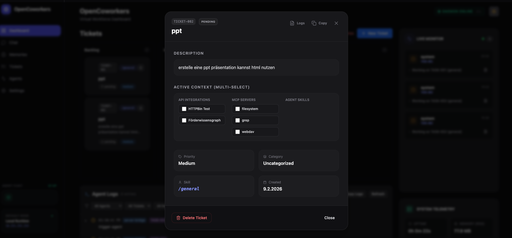
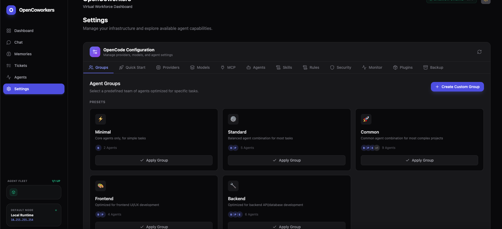
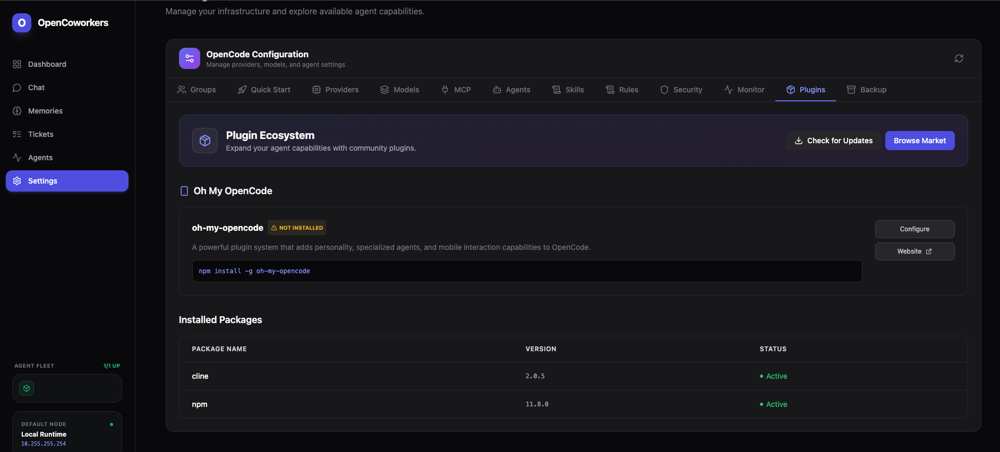
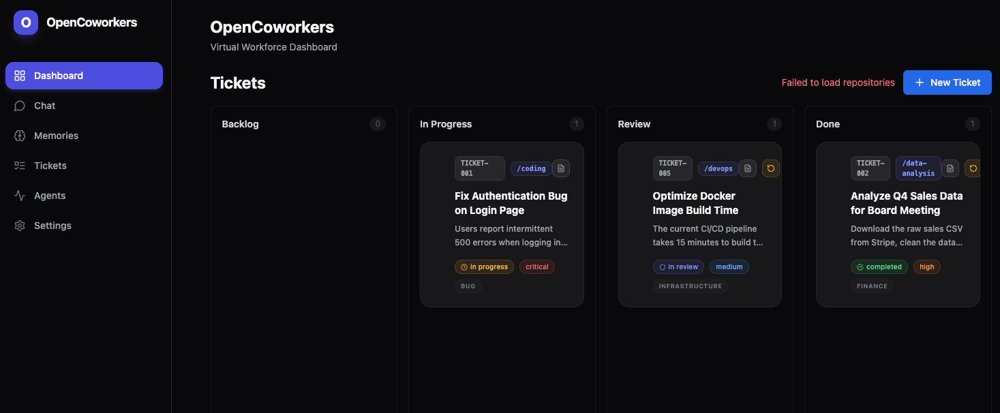

# 🤖 OpenCoworkers - Virtual Workforce Automation Platform

> **Transform your project management tool into a command center for AI agents.**
> Connect business teams with autonomous coding agents for end-to-end task automation.

[](https://opensource.org/licenses/MIT)
[](https://opencode.ai)
[]()

> **⚠️ PROJECT STATUS: ARCHIVED**
>
> This repository is currently **not actively maintained** due to the prioritization of other similar projects. However, the architecture is solid and valid.
> **We invite anyone to fork and pickup development!** The codebase is fully functional and represents a state-of-the-art implementation of the OpenCode engine.

---

## 🎯 The Vision

**OpenCoworkers** orchestrates complex, long-running development and business tasks managed via Kanban boards (Plane, Notion, Jira). It utilizes the **OpenCode** engine as its underlying agent runtime, allowing teams to hire a "virtual workforce" that lives directly inside their existing tools.

**"Stop buying AI tools. Start hiring an AI workforce that lives in your project management system."**

"Stop buying AI tools. Start hiring an AI workforce that lives in your project management system."

## 📸 Dashboard Preview



<div align="center">
  
  
</div>
<div align="center">
  
  
</div>

---

## 🏗️ Architecture (Docker-First)

OpenCoworkers runs as a 3-container stack, ensuring a safe and isolated execution environment for AI agents.

For a deep dive into the architecture and how the pieces fit together, read **[HYBRID_SETUP.md](HYBRID_SETUP.md)**. This is the best place to understand the system design.

| Container | Service | Port | Description |
|-----------|---------|------|-------------|
| **opencoworkers-ui** | Web UI | 7850 | React Dashboard for monitoring and configuration. |
| **opencoworkers-daemon** | Orchestrator | 7851 | Node.js backend. Manages PM tool sync and Agent state. |
| **opencoworkers-runtime** | Execution | 7852 | Go-based Agent Runtime (OpenCode Server). Sandboxed. |

---

## 🚀 Development Guidelines

If you want to continue development, please follow this workflow based on our established conventions:

### 1. Key Documentation
We use a structured approach to documentation and state management. Please read these files in order:

1. **[.agents/agent_commands/instructions.md](.agents/agent_commands/instructions.md)**: The "Manual" for the agent. Contains the comprehensive project context.
2. **[.agents/agent_commands/checkpoint.md](.agents/agent_commands/checkpoint.md)**: The current state of the repo and recent changes.
3. **[HYBRID_SETUP.md](HYBRID_SETUP.md)**: Detailed architecture and setup guide.

### 2. Feature Management
The **SOURCE OF TRUTH** for all development is:
👉 **[.agents/agent_commands/features.json](.agents/agent_commands/features.json)**

This file tracks every feature, its status, and verification steps. Always consult and update this file when making changes.

---

## 🚀 Quick Start

### 1. Prerequisites
- Docker & Docker Compose
- Node.js 18+ (for local development)

### 2. Setup
```bash
# Clone the repository
git clone https://github.com/enving/opencoworkers.git
cd opencoworkers

# Configure environment
cp .env.example .env
# Edit .env with your PM tool credentials (Jira, Plane, etc.)
```

### 3. Start the Workforce
```bash
docker-compose up -d
```

### 4. Access the Dashboard
Open **[http://localhost:7850](http://localhost:7850)** to see your agents in action.

---

## 💡 Key Features

- **Local-First & Isolated**: Agents run in a sandboxed Docker container (`opencode-runtime`), keeping your host system safe.
- **Workflow-Native**: No new dashboards for your team. Use Plane, Jira, or Notion labels (e.g., `automatic-review`) to trigger automation.
- **Skill-Based Routing**: Automatically routes tasks to specialized agents based on labels (e.g., `skill:pptx` for presentations, `skill:xlsx` for data analysis).
- **Enterprise Ready**: Designed for multi-agent orchestration, audit trails, and transparent execution.

---

## 📚 Documentation

## 📚 Documentation

- **[PRD.md](.agents/agent_commands/PRD.md)**: Product Requirements and Roadmap.
- **[docs/PROJECT-CONVENTIONS.md](docs/PROJECT-CONVENTIONS.md)**: Naming, ports, and disambiguation rules.
- **[Daemon Architecture](services/daemon/docs/ARCHITECTURE.md)**: Detailed breakdown of the orchestrator.
- **[docs/DEV-RULES.md](docs/DEV-RULES.md)**: Guidelines for contributing safely.

---

## 🤝 Contributing

We welcome contributions! This project is in active development (Phase 5).

1. Check **[PRD.md](PRD.md)** for current focus tasks.
2. Ensure you follow the **[DEV-RULES.md](docs/DEV-RULES.md)**.
3. Tests are located within individual service directories (e.g., `services/daemon/tests`).

---

## 📄 License

MIT License - see [LICENSE](LICENSE)

---

**Built with ❤️ by [Tristan Häfele](https://de.linkedin.com/in/tristan-wilms-812b8011b)**
*Transform your PM tool into an AI command center. Start automating today.* 🚀
